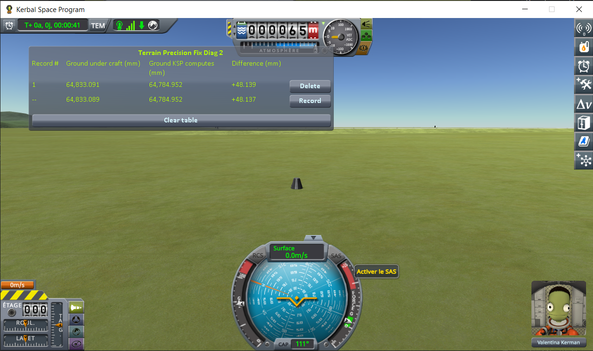

# The window

Part of [KSP Diag - Terrain Height](../README.md): the table the mod shows in flight, column by column. What the two heights are, and why they differ, is in [This mod's demonstration](this-mods-demonstration.md).

In flight, a window shows a table with one line per reading. The **bottom line is the reading in
progress**: it carries `--` where the others carry a record number, since it is not a record until the
*Record* button at the end of it freezes it into the table. The table survives scene changes, so the
lines pile up from one scene to the next. `Alt+F6` hides the window, and shows it again.

| column | meaning |
|---|---|
| **Ground under craft** | the height of the surface your craft is resting on, found by pointing a ray straight down at it |
| **Ground KSP computes** | the height the game works out for that same spot |
| **Difference** | the first minus the second |

All three are in millimetres, above sea level for the first two.

Every frozen line carries a *Delete* button, and *Clear table* throws away the lot. The table lives in
memory only, and empties itself when KSP is closed.

The bottom line is measured afresh every frame, so it follows your craft: drive a rover and you watch
both heights change as the ground under it changes. What you record has to be taken standing still —
stop, wait for the digits to stop moving, then press *Record*. That wait is the craft settling: once it
is still, the digits stop.

What the readings do not tell is in
[This mod's demonstration](this-mods-demonstration.md#what-this-instrument-shows-and-what-it-does-not).
